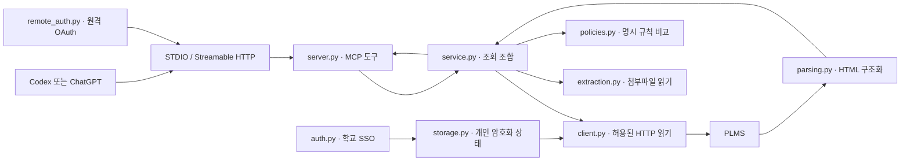

# 구조와 데이터 흐름

PLMS MCP는 한 학생의 PLMS 세션을 읽는 Python 서비스다. 모델 실행이나 OpenAI API 호출은 하지 않는다. 연결된 MCP 클라이언트가 질문을 이해하고 도구를 선택하며, 서버는 접근 가능한 PLMS 자료를 구조화해 반환한다.

## 실행 경로

STDIO에서는 MCP 클라이언트가 로컬 프로세스를 실행한다. HTTP에서는 공개 origin과 `/mcp`를 기준으로 원격 OAuth를 사용한다. 두 방식 모두 같은 서비스와 개인 상태를 사용한다.

## 모듈 책임

| 파일 | 실제 책임 |
| --- | --- |
| `cli.py` | 로그인, 쿠키 가져오기, 세션 진단, 로컬 로그아웃, 서버 실행 |
| `auth.py` | 공식 POSTECH origin 내에서 관찰된 SSO 절차 수행, PLMS 쿠키 가져오기·내보내기 |
| `storage.py` | 쿠키·선택적 로그인 정보·변경 비교 기준을 Fernet 암호문으로 저장 |
| `client.py` | HTTP 클라이언트, URL 허용 목록, 직렬 요청, 응답 크기 제한, 90초 캐시, 세션 갱신 |
| `parsing.py` | 스크립트·숨겨진 내용을 제외한 HTML 파싱, 표·활동·날짜·과제·공지·출결 구조화 |
| `service.py` | 과목별 자료 조회와 합성, 근거 봉투, 첨부 검증, 마감·검색·ICS·변경 비교 |
| `extraction.py` | 네트워크·코드 실행 없이 문서·ZIP 텍스트와 원문 위치 추출 |
| `policies.py` | 실라버스의 명시된 규칙과 관찰값을 비교하고 불확실성 표시 |
| `remote_auth.py` | 단일 소유자 OAuth 승인, DCR, PKCE 연동, 토큰 저장·갱신·폐기 |
| `server.py` | 19개 MCP 도구·리소스·프롬프트 등록, HTTP 인증·Host/Origin 방어 |
| `errors.py` | 인증 필요·위험 URL·상위 서버 오류 등의 구분 |

## 학교 로그인과 MCP 연결은 별개

학교 로그인은 로컬 CLI가 담당한다. SSO는 공식 HTTPS origin만 따라가고, 학교의 기존 암호화 로그인 봉투와 리다이렉트 절차를 호환 구현한다. 원격 JavaScript는 실행하지 않는다. MFA나 추가 브라우저 조작이 필요하면 이를 우회하지 않고 브라우저 세션 가져오기로 넘긴다.

기본적으로 검증된 PLMS 쿠키를 저장한다. 비밀번호 지속 저장은 `--save-password`를 명시한 경우에만 허용된다. 저장된 자격증명으로 세션을 갱신하다 실패하면 자동 재로그인을 비활성화하여 같은 실패를 계속 반복하지 않는다. 쿠키 교체나 CLI 로그아웃은 요청 전에 감지하며 메모리 캐시도 비운다.

원격 OAuth의 `PLMS_CONNECT_PASSWORD`는 PLMS 비밀번호가 아니다. 20자 이상의 별도 무작위 비밀이며, 개인 인스턴스에 MCP 클라이언트를 연결하는 승인에 사용한다. 동일 인스턴스에 연결한 모든 승인 클라이언트는 **동일 학생의 PLMS 세션**에 접근한다. 학생마다 별도 인스턴스·상태·키·연결 암호를 사용해야 한다.

OAuth는 `plms:read` 범위를 사용한다. 액세스 토큰은 1시간, 갱신 토큰은 30일, 인가 코드는 5분의 만료기간을 가진다. 갱신 토큰은 회전하며 재사용이 탐지된 토큰 계열을 폐기한다. 클라이언트 등록·코드·토큰 상태는 SQLite의 암호화 payload로 저장하고, 불투명 비밀 값은 해시로 조회한다. PKCE·callback 바인딩은 MCP SDK와 통합하고 `resource` 검증을 추가한다.

## 요청 제한과 캐시

| 대상 | 기본 제한 또는 동작 |
| --- | --- |
| PLMS 페이지 캐시 | URL별 메모리 캐시, 90초, 최대 256개 |
| PLMS 요청 | 하나씩 전송, 시작 간격 최소 0.15초 |
| HTTP 제한 시간 | 30초 |
| 리다이렉트 | 읽기 요청 최대 8단계, 단계마다 대상 검증 |
| HTML 응답 | 최대 4,000,000바이트 |
| 첨부파일 | 최대 25MiB |
| 본문 도구 반환 | 기본 16,000자, 요청당 최대 40,000자 |
| OAuth 요청 본문·쿼리 | 16,384바이트, endpoint별 요청 수 제한 |

첨부파일은 `source_url`을 새로 조회하여 링크가 실제로 있는지 확인한 후 다운로드한다. `plms_status`도 새 대시보드 요청을 사용한다. 나머지 조회는 캐시를 재사용할 수 있다. 공통 `retrieved_at`은 응답 구성 시각이며, 원문 서버의 수정 시각이나 매번 새로 내려받은 시각을 의미하지 않는다.

모든 수집 실패를 전체 실패로 처리하지는 않는다. 여러 과목의 마감을 모을 때 일부 접근 실패가 나면 성공한 데이터와 경고를 함께 반환한다. 이 때문에 호출자는 `warnings`, 날짜 불명 항목과 검색 범위를 확인해야 한다.

## URL와 자료 경계

`client.safe_url`은 네트워크 접근의 권한 경계다. 공식 PLMS HTTPS 호스트·표준 포트·정해진 읽기 경로·쿼리 키만 허용한다. 외부 리다이렉트, 자격증명이 포함된 URL, 중복 쿼리 값, 모호한 인코딩 경로와 지원하지 않는 경로는 거절한다. 첨부파일은 별도 다운로드 경로 제한을 적용한다. 시스템 프록시 환경을 자동 신뢰하지 않는다.

`parsing.safe_url`은 반환할 링크를 정리하는 함수다. 상대 링크를 해석하고 세션 키·토큰 등 민감 쿼리를 제거한다. 이는 네트워크 접근 허가를 대신하지 않는다. 파서가 반환한 외부 링크가 있어도 실제 읽기에서는 다시 클라이언트의 허용 목록을 통과해야 한다.

MCP 도구는 과제 제출, 메시지 전송, 시험 응시 시작, 영상 재생, 진도 전송, 출석 기록 변경을 노출하지 않는다. 학교 로그인과 로컬 인증·상태 저장은 조회를 위한 관리 작업이다. `plms_check_changes`는 PLMS를 변경하지 않지만 로컬 비교 기준을 쓰므로 MCP의 읽기 전용 힌트를 false로 명시한다.

## 날짜와 출결 해석

파서는 본문 문단을 유지하면서 인라인 날짜와 문장을 불필요하게 끊지 않는다. 표의 rowspan·colspan을 펼쳐 행의 의미를 유지한다. 스크립트·숨김 필드·일반 숨김 요소는 모델에 전달할 본문에서 제거한다.

활동 날짜 전체와 정상 학습 기간, 지각 인정 기간, 공개 조건을 따로 보관한다. 날짜에 시각이 없으면 임의의 23:59를 만들지 않는다. 연도가 없는 표현은 기계의 현재 연도로 보충하지 않는다. 과제 목록에서는 명시된 마감 열을 사용하며 제목이나 공개일에 들어간 날짜를 마감으로 택하지 않는다.

출결 표에는 아직 오지 않은 수업의 기본 표시가 있을 수 있다. 미래 날짜는 `scheduled`로 표시하고 집계에서 제외하되 `recorded_status`로 원본 표시는 보존한다. 미처리·빈칸·충돌·완전한 날짜가 없는 주차 행은 확정 결석이나 출석으로 세지 않는다. 온라인 진도와 오프라인 수업 출결은 별개로 반환한다.

## 첨부파일과 실라버스 규칙

첨부파일 추출은 메모리에서 수행한다. PDF 페이지, 문서 문단, 슬라이드, 시트·셀, HWP/HWPX 구역·문단, 텍스트 행 위치를 결과에 붙인다. ZIP은 먼저 안전한 목록을 반환하고 선택한 멤버만 읽는다. 일반 중첩 압축, 암호 ZIP, 경로 탈출, 심볼릭 링크, 과도한 압축 해제 비율·크기를 제한한다. 문서 안의 외부 링크나 매크로·소스코드를 실행하지 않는다.

추출 한도는 입력 25MiB, 압축 해제 총합 100MiB, 개별 멤버 25MiB, 멤버 3,000개, 추출 텍스트 2,000,000자, 구간 5,000개다. PDF는 1,500페이지 제한을 둔다. 한도 도달·부분 실패·OCR 필요 여부를 결과 상태와 경고로 남긴다. 텍스트 읽기 순서는 원래 시각 배치와 다를 수 있다.

규칙 엔진은 원문과 위치를 먼저 보관하고, 안전하게 해석 가능한 수치 조건만 비교한다. 관련 없는 과제를 순서만으로 매칭하지 않는다. 날짜·시각·분모가 빠졌거나 기록이 불완전하면 불확실성을 남긴다. 계산 결과는 학교의 최종 출결·성적 판정이 아니다. 별도 실라버스 파일과 이후 공지를 후속 조회해야 한다.

## 저장되는 자료

| 저장소 | 내용 | 보호와 한계 |
| --- | --- | --- |
| `cookies.enc` | 검증한 개인 PLMS 세션 | 로컬 Fernet 암호화 |
| `credentials.enc` | 명시적으로 저장한 경우의 학교 로그인 정보 | 선택 사항, 기본 지속 저장 아님 |
| `snapshots.enc` | 변경 비교의 활동·과제·공지 기준 | 강의 관련 개인 자료이므로 비공개 |
| `vault.key` | 위 암호문의 암호화 키 | 파일 권한 제한. 암호문과 키를 함께 탈취하면 보호되지 않음 |
| `oauth.sqlite3` | 개인 OAuth 클라이언트·승인·토큰 상태 | 별도 연결 암호에서 유도한 키로 payload 암호화 |
| 메모리 | 짧은 페이지 캐시와 추출 중인 첨부 | 프로세스 종료 시 소멸 |

개인 상태 디렉터리는 접근 권한 0700, 비밀 파일은 0600 수준으로 제한한다. 파일 암호화는 호스트 전체 장악이나 같은 사용자의 악성 프로세스에 대한 격리 수단이 아니다. 조회 결과는 사용자가 연결한 ChatGPT/Codex 등 클라이언트에 전달된다.

## 운영 범위

현재 원격 서버는 단일 학생·단일 worker를 기준으로 한다. OAuth rate limiter가 프로세스 내부 상태를 쓰므로 다중 worker나 다중 학생 공유 서비스로 확대하려면 별도 설계와 검증이 필요하다. 임시 HTTPS 터널은 개인 테스트 연결 수단이며, URL 지속성·컴퓨터 절전·재시작·고정 호스팅의 운영 조건은 따로 해결해야 한다.

학교 화면·SSO·첨부 경로가 바뀌면 어댑터 수정이 필요할 수 있다. 공식 학교 API나 승인된 공식 제품으로 표현하지 않는다. 연결 절차는 [clients.md](clients.md), 배포 절차는 [deployment.md](deployment.md), 기능별 범위는 [tools.md](tools.md), 검증 증거는 [verification.md](verification.md)를 참고한다.
